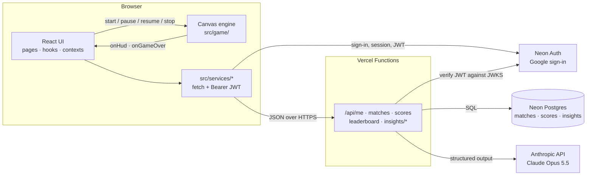
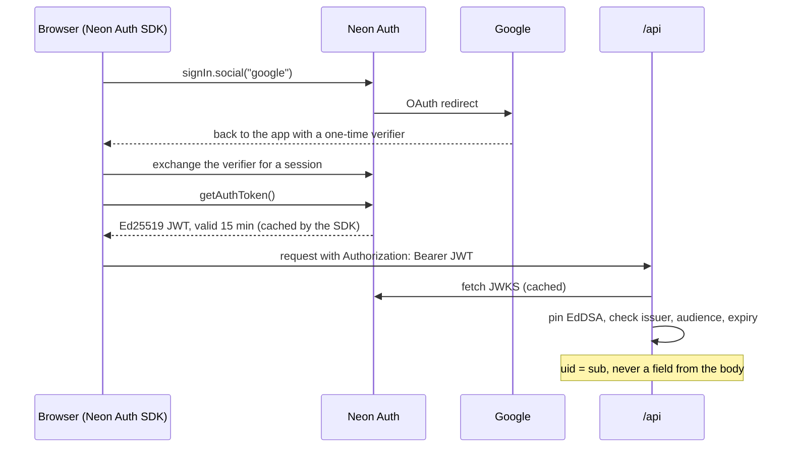
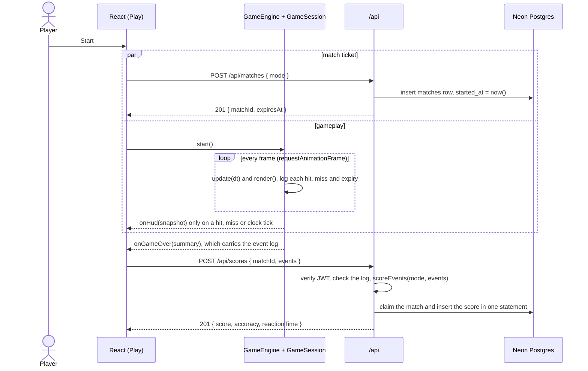
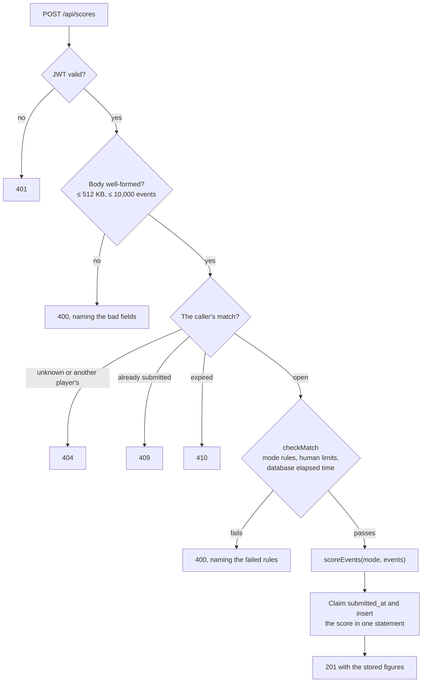
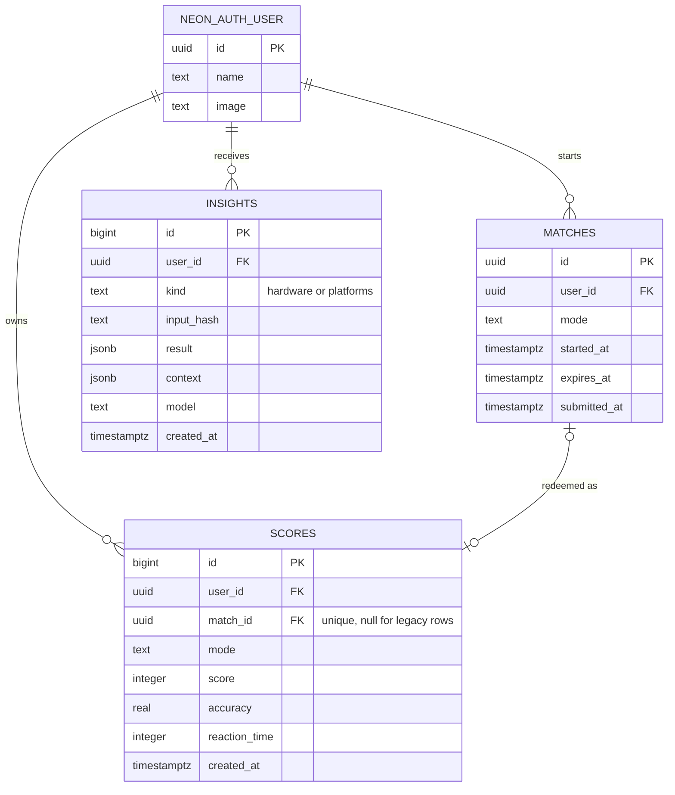
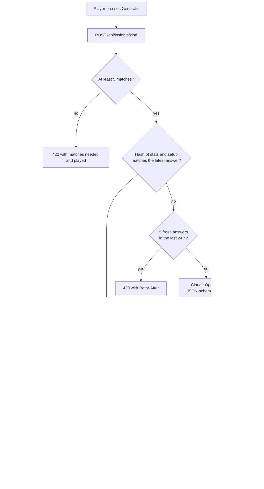

# Aim Assist

A browser-based aim trainer inspired by Aimlabs: six game modes, live statistics, Google sign-in, global leaderboards, and AI recommendations for your mouse setup and the shooters that suit your aim. Built as a portfolio project to demonstrate modern React, interactive Canvas programming, and a small serverless backend.

## Live Demo

[View my project here](https://aim-assist-v2.vercel.app)

## Problem

Serious aim trainers are desktop applications. Aimlabs ships through Steam, KovaaK's is paid, and both want an install, an account, and a launcher before you've clicked a single target. That's a lot of hassle for something people mostly want in five-minute bursts — a warm-up before a session, or a quick check of whether their tracking has actually improved.

There's no reason the core of that experience needs a native client. Hit detection, a 60 FPS render loop, and persistent stats are all things a browser does well now. The gap is that nobody has built a version you can send someone as a link.

## Value

Zero install, works on any device with a browser, free, and your stats follow you across machines through Google sign-in. Six distinct modes covering different skills — flicking, tracking, precision, target switching — plus reaction-time analytics to help FPS gamers actively work on improving their performance and competitive edge.

## Project Plan

I set out to build a browser-based aim trainer with canvas gameplay and a React interface — Aimlabs-inspired, but not an attempt to clone it feature-for-feature.

The approach was to plan the architecture completely before writing any code. A separate planning session produced three documents — a project charter, an architecture spec, and a 26-milestone implementation plan — that fixed the important decisions up front. The central one, which everything else follows from: React never animates gameplay. React owns menus, routing, auth, and statistics; the canvas engine owns the frame loop, entities, collision, and particles; they communicate through a narrow lifecycle API and event callbacks, never per-frame state. The v1 documents are archived in [`Prototype/`](./Prototype).

**v2** kept the game engine unchanged and replaced the platform underneath it. The v1 prototype ran on Firebase and GitHub Pages, with the browser talking straight to Firestore. v2 moves hosting to Vercel, data to Neon Postgres behind a small API, and sign-in to Neon Auth, removing Firebase entirely. It then adds AI recommendations through the Anthropic API. The work ran as ten small milestones, each stopping for review before it was committed. [PLAN-V2.md](./PLAN-V2.md) records every decision and how each milestone was verified.

**Server-checked scoring** answered a security audit after a 9,999,999 score reached the board: the browser had been posting its own score. The server now issues each match, the client sends the match's event log instead of a score, and the server checks the log against the mode's rules and the real time that passed before computing the score itself, with the same pure function the results screen uses. It ran as six milestones (S0–S5). [PLAN-SCORING.md](./PLAN-SCORING.md) records them, and [AUDIT-RESPONSE.md](./AUDIT-RESPONSE.md) answers the audit.

**The UI refactor** then reworked the interface without touching the engine or the API, in eight more milestones (U0–U7). The landing and 404 pages share one poster-like direction: flat colour fields and heavy display type. Play, Leaderboards, Profile and Settings share a quieter app style: tabular figures, one accent line for the selection, and a loading, empty and error state for every block. Signed-out visitors get no page links, only the way to sign in, and `/play` needs an account. Both directions were dealt by the [taste-skill](https://github.com/Leonxlnx/taste-skill) design skill and checked in headless Chrome at three widths. [PLAN-UI.md](./PLAN-UI.md) records each decision and its verification.

**Past insights** made the AI answers the database already kept visible. Each Profile panel now opens on the player's latest saved answer, with no Claude call, and a picker shows the earlier ones. A hardware answer also records the mouse setup it was for. It ran as four milestones (I0–I3). [PLAN-INSIGHTS.md](./PLAN-INSIGHTS.md) records them.

## Features

- **Six game modes** — Gridshot, Precision, Speed, Tracking, Flick, and an endless Survival mode with escalating difficulty
- **Full match loop** — countdown timer (or lives in Survival), pause/resume, results screen with reaction-time analytics, session history
- **Scoring depth** — streak-based combo multiplier (up to 2×), accuracy, avg/best/worst reaction times
- **Google sign-in** — profiles with stats derived from every match you've played (highest score, games played, average accuracy, favorite mode)
- **Leaderboards** — all-time, daily, and weekly top 100 (one entry per player, with days in UTC) and personal bests
- **Server-checked scores** — every saved score is computed by the server from the match's event log, after checks against the mode's rules and the real time played
- **AI insights** — on your profile, Claude reads your per-mode stats and recommends a DPI, sensitivity, and polling rate (optionally relative to your current mouse), and 3–5 shooters whose aiming demands suit your strengths. Past answers are kept: each panel opens on your latest one, with the earlier ones a pick away
- **Five themes** — Dark, Light, Cyberpunk, Terminal, and Aimlabs, applied to the UI *and* the canvas, remembered per browser
- **Feel** — particle bursts, floating score text, and Web Audio–synthesized sound effects (no audio assets)

### Which features considered next?

- **Replay-proof scoring** — Saved scores are now computed on the server from a checked event log (see [Architecture](#playing-and-saving-a-match)), which rules out impossible scores but not a bot that fabricates a plausible log. Closing that means a seeded, fixed-step engine and the server replaying the player's raw input, which only pays off if the boards ever carry stakes.
- **Progress charts** — Every match is already stored with a timestamp; plotting score and accuracy over time is mostly a query and a chart component, and it's the single feature that would most change how the app feels to a returning user.
- **Persistent session history** — Currently in-memory only, so a refresh clears it.
- **Sensitivity calibration** — Target sizes and speeds tuned to match the game a player is warming up for.
- **Daily challenge** — A seeded target sequence so every player gets an identical run, which makes the leaderboard meaningfully comparable in a way the current free-play boards aren't.

## Tech Stack

| Layer | Choice |
|---|---|
| UI | React 19, React Router 7, Tailwind CSS 4, self-hosted Unbounded and Onest (Fontsource) |
| Gameplay | HTML5 Canvas 2D, vanilla ES2022+ classes |
| API | Vercel Functions (`/api`), JWTs verified with `jose` |
| Database | Neon Postgres, plain SQL migrations, `@neondatabase/serverless` |
| Auth | Google sign-in through Neon Auth |
| AI | Anthropic API (Claude Opus 5.5), structured JSON output, server-side only |
| Hosting | Vercel, with GitHub Actions running lint, tests, and build |
| Build | Vite 8 (Rolldown) |
| Quality | ESLint 10, Prettier, Vitest + React Testing Library (430+ tests) |

## AI Tools Used

The v1 planning phase was completed in conjunction with OpenAI's ChatGPT, and the implementation with Claude's Fable model; see the [v1 prompt history](./Prototype/V1-PROMPT-HISTORY.md). v2 was planned and built with Claude Code, milestone by milestone, with each one stopping for my review before it was committed. The [v2 prompt history](./PROMPT-HISTORY.md) (and its archives: [1](./PROMPT-HISTORY-2026-Q4.md), [2](./PROMPT-HISTORY-2026-Q4-02.md), [3](./PROMPT-HISTORY-2026-Q4-03.md)) records each request, the decisions behind it, and how it was verified.

## Architecture



Three rules hold the design together:

1. **React never animates gameplay.** The `GameEngine` owns the `requestAnimationFrame` loop and pushes stats to React only when something displayed changes (hit, miss, or second tick) — never per frame. A game mode is pure configuration (`src/game/modes.js`); all six modes and the difficulty ramp run on the same engine with zero bespoke mode logic.
2. **The browser never touches data directly.** Every database read and write, every token check, and every AI call happens in `/api`. The browser reaches it only through `src/services/*`.
3. **Identity comes from a verified token, never from the request body.** `/api` takes the user id from the `sub` of a Neon Auth JWT it has verified.

### Sign-in and identity

Sign-in is a full-page redirect through Google and back. After that, every `/api` call carries a short-lived JWT, and the server derives the caller from it.



### Playing and saving a match

The browser never sends a score. The server issues a match ticket when the round starts, and at game over the client sends the match's event log. The server checks the log and computes the score with the same pure `scoring.js` the results screen uses, so the two always agree.



Each submission passes the same gates in order, and every refusal has its own status, which the results screen words as *rejected* rather than as an outage:



Because the claim and the insert happen together, a replayed request finds nothing to claim. A composite foreign key from `scores` to `matches` makes the database refuse a score whose player or mode differs from its match's.

### Leaderboards and profile stats

Nothing derived is stored. `GET /api/me` computes games played, best score, average accuracy and favourite mode from `scores` on every read, so two matches saved at once can't lose an update. The all-time, daily and weekly boards keep each player's best entry with `DISTINCT ON (user_id)`, rank the top 100 in UTC windows, and join names and avatars live from Neon Auth's user table.



### AI insights

Each Profile panel opens on the player's saved answers, a plain database read with no Claude call. Only the Generate button can reach Claude, and the server puts three gates in front of that paid call: enough matches to say something, a cache keyed by the inputs, and a daily cap.



See [ARCHITECTURE.md](./ARCHITECTURE.md) for the full design: every route, the `api/_lib` modules, the security model and the test strategy.

## Getting Started

You need Node 24 and a [Vercel](https://vercel.com) account. Neon and Neon Auth come through Vercel's Marketplace.

```bash
npm install
npm i -g vercel
```

One-time setup:

1. **Vercel project.** Import the repo into Vercel (it detects Vite).
2. **Database and auth.** In the project, add **Neon** from Storage (Marketplace) and connect it to all environments. This creates the database, enables Neon Auth, and injects `DATABASE_URL`, `NEON_AUTH_BASE_URL`, `VITE_NEON_AUTH_URL` and related variables.
3. **AI key.** Add `ANTHROPIC_API_KEY` under Settings → Environment Variables. It's server-only, so never give it a `VITE_` prefix.
4. **Local env.** Link the folder and pull the variables:

   ```bash
   vercel link
   vercel env pull .env.local
   ```

   [`.env.example`](./.env.example) lists every variable and which side reads it.
5. **Schema.** Apply the migrations in [`db/migrations/`](./db/migrations):

   ```bash
   npm run db:migrate
   ```

   Each file runs in a transaction and is recorded, so reruns skip what's applied.
6. **Sign-in.** In the Neon Console → Auth, add `http://localhost:3000` as a trusted domain. Neon's shared Google keys work for development; use your own Google OAuth client before going public.

Then run the app and API together:

```bash
npm run dev:full   # vercel dev → http://localhost:3000
```

### Scripts

| Command | Purpose |
|---|---|
| `npm run dev:full` | Vite and the `/api` functions on one port (`vercel dev`) |
| `npm run dev` | Vite only, with HMR. There's no `/api`, so data and sign-in won't work. |
| `npm run build` / `preview` | Production build / local preview |
| `npm run db:migrate` | Apply new SQL migrations to the database in `.env.local` |
| `npm run db:legacy-report` | Read-only: list scores saved before server-checked scoring that fail its bounds |
| `npm test` / `test:watch` | Vitest suite (game logic, API helpers, services, components) |
| `npm run lint` / `format` / `format:check` | ESLint / Prettier |

## Engineering Notes (findings from the build)

Things this codebase demonstrates that a reviewer might care about:

- **The scene contract paid off.** `GameEngine` drives any `{ update(dt, size, input), render(ctx, size) }` object. That one abstraction absorbed the demo scene, six game modes, difficulty scaling, and particle systems without ever rewiring the loop.
- **React renders are event-driven, not frame-driven.** The HUD re-renders on hits/misses/second-ticks only; memoized components (`GameHud`, `Leaderboard`, `SessionHistory`) shield the rest. The canvas hits 60 FPS with zero React involvement.
- **Postgres simplified the data model.** v1's Firestore needed `day`/`week` key fields, three composite indexes, and player names copied onto every score. In v2, `DISTINCT ON` gives one-entry-per-player boards in a single query, a join supplies names and avatars, and profile stats are derived on read instead of stored, so concurrent matches can't lose an update.
- **The server computes the score.** The browser sends a match's event log, not its score. The server holds the log to rules derived from the engine itself (each hit inside its target's lifespan, targets no faster than the spawner makes them) and to human limits, then scores it with the same pure module the results screen uses. One SQL statement claims the match ticket and stores the score, so a replayed request saves nothing.
- **Validation in two places.** Every input is checked in the handler (the 400 names the bad fields) and again by SQL `CHECK` constraints. The browser can't choose whose data it reads or writes: the user id comes from the verified JWT.
- **Structured AI output, still checked.** Claude answers against a JSON schema, and the server then checks what a schema can't express (DPI range, 3–5 distinct picks) before anything reaches the UI. Answers are cached by a hash of their inputs and capped at 5 fresh ones per player per day, so repeat requests are instant and free.
- **Dependencies are injected at the edges.** The JWT verifier, the database queries, and the Claude client are factories wired from environment variables in one place each, so the whole suite runs without a network, and the real SQL was exercised against in-process Postgres (PGlite).
- **Zero-asset audio.** All sound effects are synthesized with the Web Audio API (oscillator + exponential-decay envelope), created lazily after a user gesture to satisfy autoplay policies.
- **Bundle discipline.** Route-level code splitting plus Rolldown `advancedChunks` keeps the entry chunk at 3.6 kB gzip, with React (72 kB) and the Neon Auth SDK (67 kB) in independently cached vendor chunks. Removing Firebase dropped its 141 kB chunk.
- **Frame-loop hygiene.** Delta time is clamped (backgrounded tabs can't cause physics jumps), pause re-anchors the clock, hit-testing uses the full target radius (shrinking targets stay fair), and hot paths avoid per-frame allocations.

## License

Personal portfolio project — no license granted for reuse.
