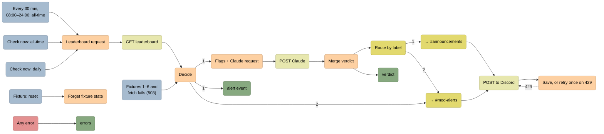
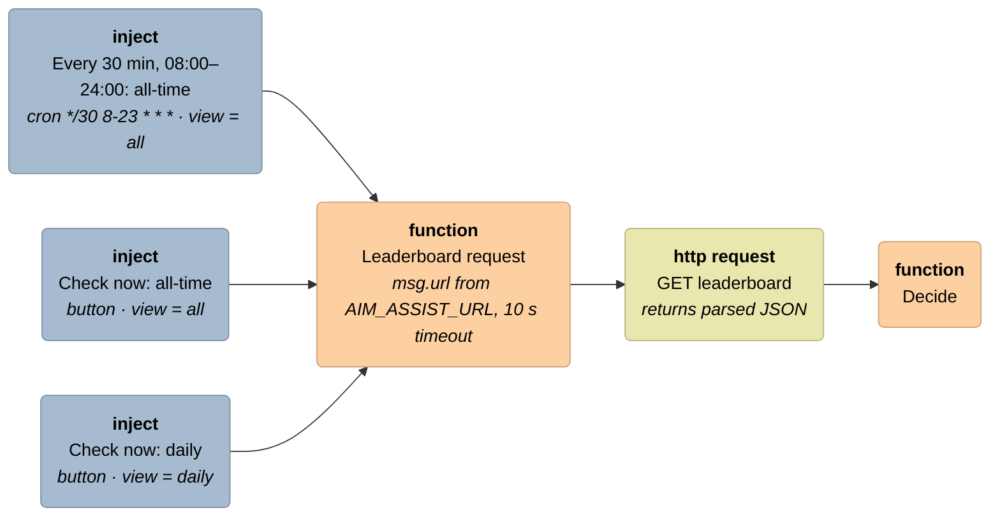
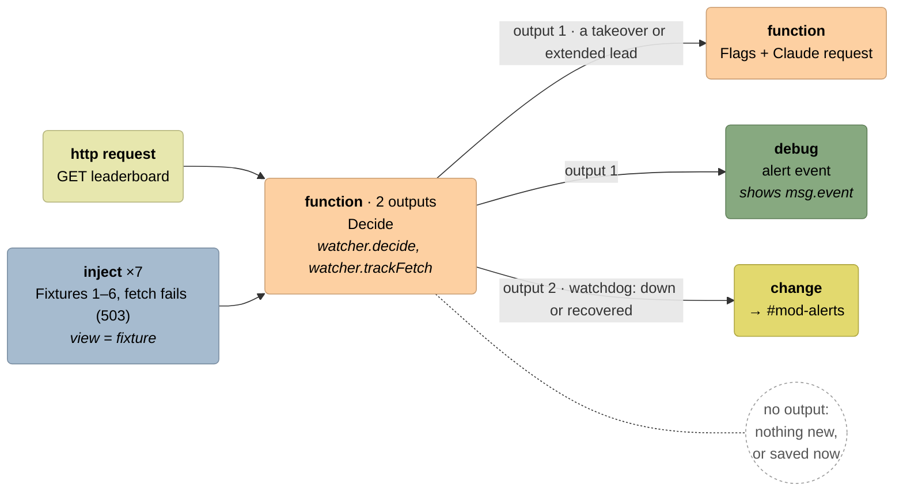
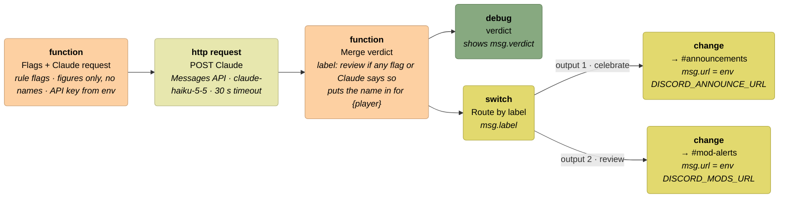
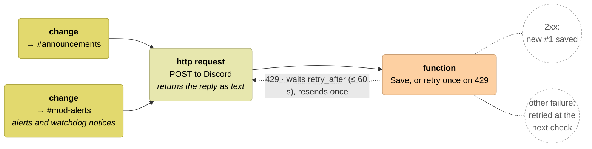
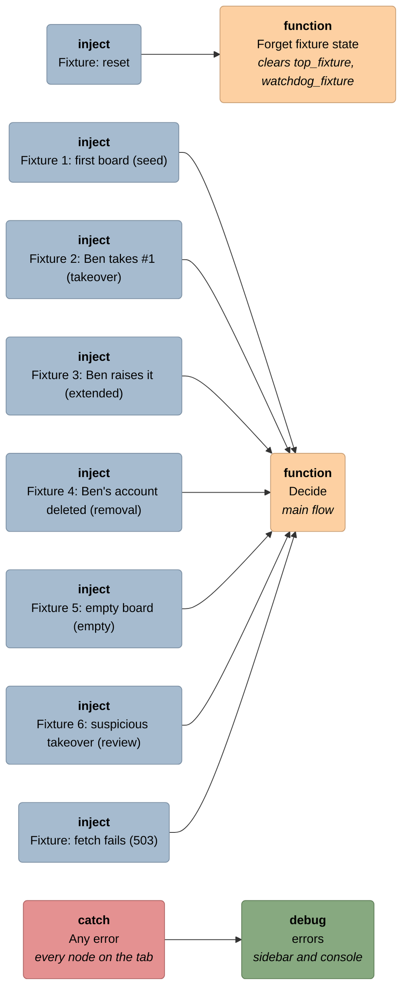

# The Node-RED editor: the Leaderboard watch tab

The flow runs in Node-RED on the owner's machine, so its editor isn't something a reviewer can open. This page draws what the **Leaderboard watch** tab looks like at `http://localhost:1880`. The nodes, names, wires and output ports come from [`leaderboard-watch.flow.json`](leaderboard-watch.flow.json), and each node is coloured the way the editor colours its type. How the pieces work is in [BUILD-LOG.md](BUILD-LOG.md).

The canvas has three rows. The **main flow** runs left to right across the top. The **error catcher** sits under its left end, and the **fixtures** are stacked below that. Two comment nodes label the main flow and the fixtures; they have no wires and aren't drawn here.

## The whole tab

## Node types

| Colour in the editor | Type | Nodes on this tab |
|---|---|---|
| Grey-blue `#a6bbcf` | inject | The timer, **Check now** ×2, the fixtures ×8 |
| Orange `#fdd0a2` | function | Leaderboard request, Decide, Flags + Claude request, Merge verdict, Save or retry, Forget fixture state |
| Pale yellow `#e7e7ae` | http request | GET leaderboard, POST Claude, POST to Discord |
| Yellow `#e2d96e` | switch, change | Route by label; → #announcements, → #mod-alerts |
| Green `#87a980` | debug | alert event, verdict, errors |
| Red `#e49191` | catch | Any error |

A function node's code is a few lines of glue. The decisions come from the repo's [`watcher/`](watcher/) modules, which `settings.js` loads as `global.get('watcher')`. Secrets come from `env.get()`, so no node holds one.

## 1. Trigger and fetch

The timer checks the all-time board only. Each **Check now** button checks its board straight away, and the daily one is what the demo uses.

## 2. Decide: two outputs

Decide sends nothing on output 1 when the board hasn't changed. It also sends nothing when the change needs no alert (the first check, a removal, an empty board): it saves that state straight away. Output 2 fires only on the 3rd failed fetch in a row, and on the first success after that.

## 3. The AI step and routing

If Claude fails (an error, a refusal or bad JSON), Merge verdict lets the rules decide and sends the plain factual post instead, so the alert still goes out.

## 4. Posting and saving

The wire from **Save, or retry** back into **POST to Discord** is the one loop on the canvas. The new #1 is saved only after Discord accepts the post, so a failed alert is tried again at the next check.

## Fixtures and errors

The fixtures skip the fetch and feed a fake board straight into Decide, under view `fixture`, with their own saved state. Press **Reset**, then 1 to 5 in order; 6 works any time after 1. Fixtures 2, 3 and 6 go through Claude and post to Discord like real alerts. Pressing **fetch fails** 3 times brings the watchdog notice.

## What the status lines say

In the editor, each function node shows a coloured dot or ring and a short text under it after it runs. A green or yellow dot means it worked; a red ring means a failure.

| Node | Status | Means |
|---|---|---|
| Decide | 🟢 `all: none at 14:31` | Checked, nothing changed. Also `seed`, `removal` and `empty`, all saved. |
| Decide | 🟡 `daily: takeover at 14:37` | A new #1, passed on to Claude. Also `extended`. |
| Decide | 🔴 `all: fetch failed (503) at 15:00` | The board couldn't be read. State unchanged. |
| Merge verdict | 🟢 `daily: celebrate` / 🟡 `daily: review` | The final label. `(rules only)` is added when Claude gave no verdict. |
| Save, or retry once on 429 | 🟢 `daily: posted takeover at 14:37` | Discord accepted it, and the new #1 is saved. Also `posted watchdog down`. |
| Save, or retry once on 429 | 🟡 `all: rate-limited, retrying in 2 s` | Discord sent a 429. One retry is scheduled. |
| Save, or retry once on 429 | 🔴 `all: post failed (500) at 15:00` | Not saved, so it's tried again at the next check. |
| Forget fixture state | ⚪ `fixture state cleared` | The fixture board starts over. |

## What travels on each wire

| Wire | The message carries |
|---|---|
| inject → Leaderboard request | `view`: `all` or `daily` |
| Leaderboard request → GET leaderboard | `url`, `requestTimeout` |
| GET leaderboard → Decide | `statusCode`, `payload.entries` (the board, best first) |
| Decide output 1 → Flags + Claude request | `event` (`kind`, `current`, `previous`, `runnerUp`), `nextState`, `stateKey` |
| Decide output 2 → #mod-alerts | `notice` (`down` or `recovered`), the webhook body in `payload` |
| Flags + Claude request → POST Claude | `flags`, the API request in `payload`, the key in `headers` |
| POST Claude → Merge verdict | Claude's response in `payload` |
| Merge verdict → Route by label | `label`, `verdict`, the webhook body in `payload` and `post`. It's a fresh message, so the API key stops here. |
| change → POST to Discord | `url`, the webhook's address from env |
| POST to Discord → Save, or retry | `statusCode` and Discord's reply. The body to resend is kept in `post`. |
